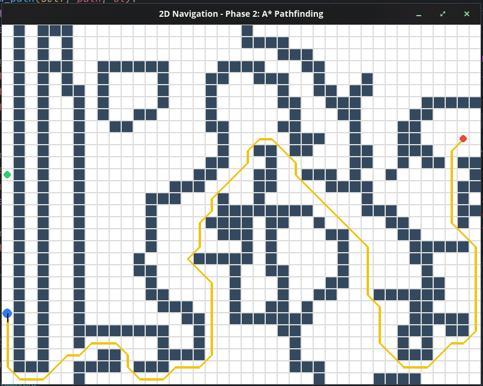

# Robot 2d navigation using pygame simuation

## Methodology:
- Find the shortest path to reach the goal using A* algorithm
- Also identify if the neighbour are the obstacles
- Calculating before move to the goal.
- It'll check 8 direction.

## Guides:
- Mouse right click to move the starting point
- Mouse wheel click or 'G' from keyboard to set the goal.
- Mouse left click to set draw the obstacles.
- 'SPACEBAR' to Run the simulation.
- key 'C' from keyboard to clear the obstacles and path.

## output

<i>Note: Starting point is green, Blue is the robot, yellow is path, Red is goal.</i>

## Improvement
- If possible to calculate real time, from the current possition if the neighbour is the obstacle or not.
- Maybe next time diagonal checking should be remove.

